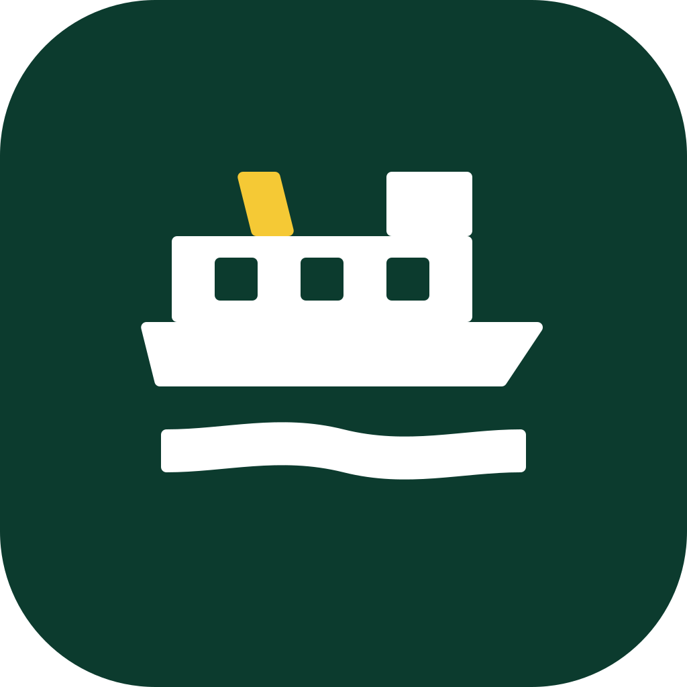
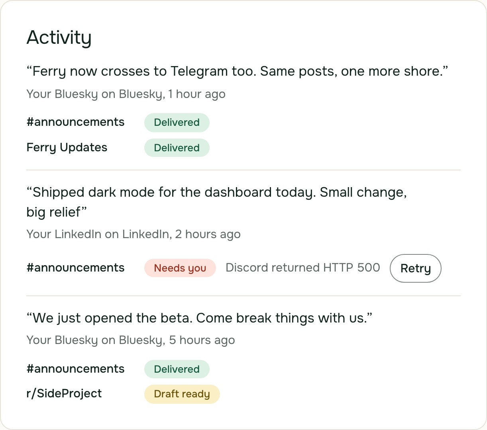
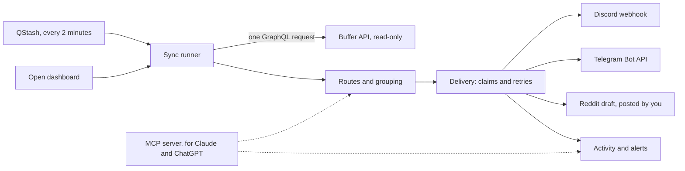
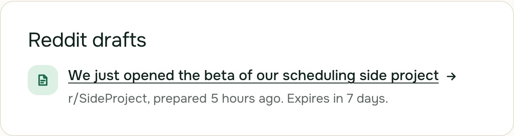

<p align="center">
  
</p>

# Ferry

**Ferry carries your Buffer posts to the places Buffer doesn't go.**

**Live at [ferry-crossing.vercel.app](https://ferry-crossing.vercel.app).** Sign in with your Buffer account to try it, or [watch the 2-minute demo](https://youtu.be/iPw0kfuJX1g) first.

Keep writing and scheduling in Buffer. When Buffer publishes a post, Ferry sends it on to your Discord channels and Telegram chats, usually within about 3 minutes, and turns it into a Reddit draft that you post with one tap. You never write a post twice, and Buffer stays the only place you write.

Ferry signs in with Buffer using read-only access. It can read your Buffer posts. It can't post, edit or delete anything.

Ferry is my entry for [Buffer Commit](https://buffer.com/api/commit), a contest for apps built on Buffer's API. All of it was built during the contest, apart from a few sign-in and setup helpers adapted from an earlier project of mine ([details below](#adapted-from-sunrise)).

<picture>
  <source media="(prefers-color-scheme: dark)" srcset="app/(site)/screens/activity-dark.jpg">
  
</picture>

## Why Ferry

Buffer publishes to the big social networks, but plenty of people also run a community somewhere Buffer doesn't reach. Buffer's own [suggestion board](https://suggestions.buffer.com) shows it: three of its most-voted channel requests are Reddit (3.0K votes), Telegram (1.5K) and Discord (1.4K), as of November 2, 2026.

Ferry adds those three without adding a second composer. You set up _routes_ once: these Buffer channels go to that Discord channel, optionally only the posts with a certain tag from Buffer's own composer. After that, posts cross on their own.

## Where posts land

| Place        | What arrives                                                                                                                                      |
| ------------ | ------------------------------------------------------------------------------------------------------------------------------------------------- |
| **Discord**  | A message under your Buffer channel's name and avatar, with its images, their alt text, and a button back to the original post.                   |
| **Telegram** | A post in your channel or group, with its photos or video and a button back to the original.                                                      |
| **Reddit**   | A draft with the title and text filled in. One tap opens Reddit's post form with both in place, and nothing is posted until you press Post there. |

A thread arrives whole, with its later parts numbered. A post you send to several Buffer channels at once arrives once in each place.

The dashboard shows every post with each place it reached. A failed delivery says why, with a Retry button. Ferry raises an alert when Buffer couldn't publish a post or a channel needs attention, and alerts can also go to a private Discord channel or a Telegram DM.

## Why not Zapier?

General automation tools can forward a Buffer post to Discord. Ferry is built around how Buffer works:

- **Nothing new to learn.** Routes follow your Buffer channels and the tags in Buffer's own composer, so there's no second place to write.
- **One arrival per post.** A post sent to several Buffer channels arrives once, even when Buffer created a separate post for each channel.
- **The whole post.** Threads arrive whole and numbered, and images keep their alt text in Discord.
- **Failures you can see.** A failed delivery says why and offers Retry. A post Buffer couldn't publish raises an alert with Buffer's own error message and help link.
- **Reddit, the way Reddit wants it.** A prepared draft and a person on the last click, instead of a bot.
- **Read-only, and polite.** Ferry can't change anything in Buffer, and it paces itself by Buffer's own rate-limit headers.

## How it works



Ferry is a Next.js 16 app that runs on Vercel, with Upstash Redis for storage and Upstash QStash as its clock. It has six runtime dependencies: Next.js, React, React DOM, iron-session and Upstash's two clients. The MCP server and the OAuth behind it are written by hand. The pure parts, such as when to check, how to route and how a post becomes a Discord message, take the clock as a parameter, so the tests set the time.

### Polling that stays cheap

Buffer's API has no webhooks, so Ferry has to ask. It can ask rarely, because a scheduled post already says when it will go out.

**One request per check.** Each check is a single GraphQL request that covers every Buffer organization with a channel on a running route. For each organization, it asks for:

- the posts sent or failed since the last check, with a 6-hour overlap so nothing slips through a gap;
- the IDs and times of posts scheduled in the next 48 hours;
- the state of the channels: locked, disconnected or queue paused.

Ferry reads a post's content only after Buffer sends it, so edits made while a post waits in the queue are always picked up. Locked channels are left out of the posts part, because Buffer refuses a whole query that names one.

**When to check.** Ferry plans each account's next check, taking the earliest of:

- a minute after a scheduled post is due, with posts due within 3 minutes of each other sharing one check;
- a recheck for a post that's due but still sending, after 2, 4, 8 and 16 minutes, then every 30;
- a heartbeat, which catches posts published right away;
- about once a minute while the dashboard is open.

QStash wakes Ferry every 2 minutes. Each tick runs the checks that are due, for up to 25 accounts, then works through any retries.

**The budget comes from Buffer.** Every response carries a `RateLimit` header with what's left in each window. Ferry keeps 20% in reserve, shares the rest among the accounts it serves, and sets the heartbeat by the tightest window, between 15 minutes and 6 hours. A 429 waits out Buffer's `Retry-After`, plus a little jitter. The dashboard's live checks stop whenever a window drops below 20 calls.

**Real numbers.** On November 11, 2026, Buffer's `RateLimit` header gave Ferry's app client 110 calls per 15 minutes, 525 a day and 15,100 per 30 days. With one account, that budget would allow a check about every 4 minutes, so the heartbeat sits at its 15-minute floor. That's 96 calls a day, plus one for each cluster of scheduled posts: about a fifth of the daily limit. The dashboard shows the day's count next to the time of the next check.

### Each post arrives once

Buffer's API treats a post sent to X and Bluesky as two posts, one per channel. Ferry groups the copies by Buffer's content item, or when there's none, by a fingerprint of their words and first image. One message goes out per group, with a button back to each network's copy.

Before each send, Ferry claims the delivery in Redis with `SET NX`, per destination:

- the group, for 24 hours;
- the words and first image or video, for 24 hours, which catches copies with different content items, such as posts created one channel at a time through Buffer's API;
- each Buffer post, for 45 days.

If a claim is already taken, the post has already gone there. A failed send is retried after 1 minute, 5 minutes, 30 minutes and 3 hours, carrying on after any parts that already went out. After the fifth try, it waits on the dashboard as Needs you, with a Retry button, for a day. If a Discord webhook is deleted or a Telegram chat removes Ferry, Ferry pauses the routes to it and raises an alert.

There's one case where a post can arrive twice: Discord or Telegram accepts the message, but its reply doesn't come back within 20 seconds. Neither API takes an idempotency key, so Ferry retries rather than risk losing the post.

### Reddit gets a draft, on purpose

Reddit ended self-service API access in November 2025, and new apps now need a manual review. Reddit's communities are also wary of automated posting. So Ferry prepares the post, and you make the last click.

For a route to a subreddit, each post becomes a draft:

- **Title:** the post's first sentence, without links or hashtags, up to 120 characters.
- **Body:** the full text and thread, without trailing hashtags, ending with a link to the original.
- **Link post** instead, when the post is mainly a link.

The draft appears on your dashboard. If your alerts go to Discord or Telegram, Ferry also sends a notice there, with a button that opens Reddit's own submit form, filled in. Nothing is posted until you press Post there. Each draft also has its own page for 7 days, at an unguessable link that works without signing in, so it opens from Discord or Telegram on your phone. Reddit doesn't accept images through a link, so the page lists them for you to attach.

<picture>
  <source media="(prefers-color-scheme: dark)" srcset="app/(site)/screens/drafts-dark.jpg">
  
</picture>

## Use Ferry from Claude or ChatGPT

Ferry has its own [MCP](https://modelcontextprotocol.io) server, so an AI app can tell you what crossed today, why a post didn't arrive, or help you sharpen a Reddit draft and hand you a link to post it.

To connect it, add a custom connector with your Ferry's address followed by `/mcp`. The exact address is under Settings → AI assistants on your dashboard.

- **Claude:** Customize → Connectors → Add custom connector.
- **ChatGPT:** chatgpt.com/plugins, then Add → Add custom MCP server. ChatGPT already lists an unrelated app called Ferry, so give yours another name, such as Ferry for Buffer.

Then sign in with Buffer when the app asks. The consent screen has an unticked box that lets the app make changes. Tick it only if the app should have the tools marked Yes below.

| Tool                          | What it does                                                                                           | Needs changes allowed |
| ----------------------------- | ------------------------------------------------------------------------------------------------------ | --------------------- |
| `get_overview`                | Your Buffer connection, channels, routes, destinations, problems, the next check and today's API calls | No                    |
| `list_activity`               | Up to 50 recent posts, each with how it went at every destination                                      | No                    |
| `list_reddit_drafts`          | The last 7 days of Reddit drafts                                                                       | No                    |
| `make_reddit_link`            | A link to Reddit's submit form, filled in with a draft you improved together                           | No                    |
| `add_subreddit`               | Adds a subreddit for drafts, or finds it if it's already there                                         | Yes                   |
| `create_route`                | Sends future posts from Buffer channels to a destination, optionally only posts with certain tags      | Yes                   |
| `pause_route`, `resume_route` | Pauses or resumes a route                                                                              | Yes                   |
| `retry_delivery`              | Sends a failed post again                                                                              | Yes                   |
| `send_latest_post`            | Sends a route's newest post now, as a test                                                             | Yes                   |

No app can delete anything, connect Discord or Telegram, or change anything in Buffer. No tool returns a token, webhook or chat ID. Disconnect an app under Settings at any time.

Under the hood, Ferry is its own OAuth server for this: dynamic client registration, PKCE, one-hour access tokens, and single-use refresh tokens that end the connection if a spent one comes back. It speaks MCP versions 2025-03-26, 2025-06-18 and 2025-11-25.

### Buffer and Ferry in one chat

Buffer has its own MCP server too, at `https://mcp.buffer.com/mcp`, which writes and schedules posts. Ferry's covers what happens after Buffer publishes. Connect both to the same app, and one chat can write a post, schedule it in Buffer, and then confirm where Ferry carried it.

[`skills/buffer-and-ferry`](skills/buffer-and-ferry/SKILL.md) is a Claude skill that teaches Claude to use the two together. Ask it to "announce that the new version is live, everywhere", and Claude:

1. reads your Ferry routes, so the post goes out on the right Buffer channels with the right tag, and tells you every place it will land;
2. asks before anything goes public;
3. creates the post in Buffer, one channel per call;
4. tells you when Ferry will carry it, and checks later that it arrived;
5. turns the Reddit draft into a version written for that subreddit, with a one-click link to post it.

To install it in Claude, zip the `buffer-and-ferry` folder, so the zip holds the folder itself. Then go to Customize → Skills, and choose + → Create skill → Upload a skill. Skills need code execution, which is under Settings → Capabilities. In Claude Code, copy the folder into `~/.claude/skills/` instead.

## Privacy

- Ferry asks Buffer for exactly `account:read posts:read offline_access`. No code path writes to Buffer.
- Buffer tokens and Discord webhook tokens are encrypted at rest with AES-256-GCM, and they never reach the browser. The session cookie holds only your account ID.
- Activity keeps the first 80 characters of each post for 30 days, and Reddit drafts last 7 days. A full copy of a post is kept only while Ferry delivers it, and for a day after the last try, so you can retry it.
- Tokens, webhook tokens and post text are never written to Ferry's logs. There are no analytics and no ads.
- Delete my data, under Settings, deletes your data from Ferry, disconnects every AI app and signs you out. A few records that hold only IDs, such as delivery claims, run out on their own. Nothing changes in Buffer.

The privacy page in the app lists everything Ferry stores and for how long, and it's written from [the code](<app/(app)/privacy/page.tsx>).

## Security

- Signing in with Buffer uses PKCE and a one-time `state`. Connecting Discord checks a `state` too, so no one can attach their webhook to your account, or yours to theirs.
- Every dashboard action, and every tool an AI app calls, reads and changes only the signed-in account's routes, destinations and deliveries.
- `/api/tick` does nothing unless QStash signed the request.
- Only a group's admins can connect a Telegram group, so a member can't post through Ferry's bot into a group that someone else connected.
- No page of Ferry's can be shown inside another site's frame, and the AI consent screen accepts only its own form.

## Known limits

- **Telegram:**
  - It has no alt text, so images arrive there without their descriptions.
  - It fetches media by URL, up to 5 MB for photos and 20 MB for other files. Anything larger arrives as a link.
  - A group upgraded to a supergroup gets a new chat ID, so it has to be connected again.
  - Ferry reads Telegram's updates only while its Connect panel is open, so a chat links only while you have the panel up.
  - Two copies of Ferry can't share one bot, because each would take the other's updates.
- **Videos on Discord** arrive as their thumbnail, with the button back to the original.
- **Discord channel names:** Discord's sign-in doesn't share the channel's name, so a new Discord destination starts as "Discord channel". Rename it under Destinations on the dashboard.
- **Different words, different messages.** If you word a post differently for each network, each version arrives separately. To avoid that, route just one of those channels.
- **Routes look forward.** A route carries posts published after it was created, and posts published while it's paused never cross.
- **Locked channels** can't feed a route until you unlock them in Buffer.
- **Posts published right away** can wait up to one heartbeat, which is 15 minutes with one account, unless the dashboard is open.
- **Reddit drafts** need their images attached by hand. A very long body doesn't fit in Reddit's link, so the draft page keeps it for you to copy.
- **The rare duplicate** described above, when Discord or Telegram times out after accepting a message.

## Run it yourself

You need Node 24 and:

- **A Buffer app client.** In Buffer, open Settings → API → App Clients, and add the redirect URI `https://localhost:3000/api/auth/buffer/callback`. Buffer requires HTTPS, even locally, so `npm run dev` serves HTTPS with a certificate Next.js makes for you.
- **A Discord application,** with the redirect URI `https://localhost:3000/api/discord/callback` under OAuth2 → Redirects.
- **A Telegram bot,** if you want Telegram. Create it with [@BotFather](https://t.me/BotFather).
- **Upstash Redis and QStash,** for production. In development, Ferry keeps its data in memory, and a restart wipes it.

Then:

```bash
git clone https://github.com/Reonid/ferry.git
```

```bash
cd ferry && npm install && cp .env.example .env.local
```

Fill in `.env.local`, then start Ferry at `https://localhost:3000`:

```bash
npm run dev
```

| Variable                                                | What it's for                                                                                                                                    |
| ------------------------------------------------------- | ------------------------------------------------------------------------------------------------------------------------------------------------ |
| `NEXT_PUBLIC_BASE_URL`                                  | Ferry's own address, such as `https://localhost:3000`, with no slash at the end.                                                                 |
| `SESSION_SECRET`                                        | Encrypts the session cookie. At least 32 characters.                                                                                             |
| `ENCRYPTION_KEY`                                        | 32 random bytes in base64. Encrypts Buffer tokens and Discord webhook tokens at rest.                                                            |
| `BUFFER_CLIENT_ID`, `BUFFER_CLIENT_SECRET`              | Your Buffer app client.                                                                                                                          |
| `DISCORD_CLIENT_ID`, `DISCORD_CLIENT_SECRET`            | Your Discord application.                                                                                                                        |
| `UPSTASH_REDIS_REST_URL`, `UPSTASH_REDIS_REST_TOKEN`    | The database, required in production. Ferry also accepts `KV_REST_API_URL` and `KV_REST_API_TOKEN`, the names Vercel's Upstash integration uses. |
| `QSTASH_CURRENT_SIGNING_KEY`, `QSTASH_NEXT_SIGNING_KEY` | Check that calls to `/api/tick` come from QStash.                                                                                                |
| `QSTASH_TOKEN`                                          | Used only by `npm run schedule`, to create the schedule.                                                                                         |
| `TELEGRAM_BOT_TOKEN`, `TELEGRAM_BOT_USERNAME`           | Your bot's token, and its username without the @. Leave both empty to turn Telegram off.                                                         |
| `FERRY_DEV_LOGIN`                                       | Set to `1` by `npm run dev:e2e`, for the browser tests. It works only in development with no database configured.                                |

Make `SESSION_SECRET` and `ENCRYPTION_KEY` with:

```bash
openssl rand -base64 32
```

### Deploy

1. Import the repository into Vercel and add the variables above, with a new `SESSION_SECRET` and `ENCRYPTION_KEY` for production. Set `NEXT_PUBLIC_BASE_URL` to the production address exactly, because AI apps reach Ferry through it.
2. Add the production redirect URIs to the Buffer app client and the Discord application: `https://your-domain/api/auth/buffer/callback` and `https://your-domain/api/discord/callback`.
3. Create the schedule that wakes Ferry every 2 minutes. The script refuses a localhost address, and it won't make a second schedule for the same address:

```bash
QSTASH_TOKEN=... NEXT_PUBLIC_BASE_URL=https://your-domain npm run schedule
```

### Tests

CI runs all of these on every push:

```bash
npm run lint && npm run typecheck && npm run format:check && npm test
```

```bash
npm run test:e2e
```

`npm test` runs 615 unit tests with Vitest. `npm run test:e2e` runs 51 Playwright tests, each on a desktop and a phone-sized screen. They include axe accessibility checks in light and dark mode, and they run against a seeded account in an in-memory store, so they need no real keys.

## Adapted from Sunrise

Buffer Commit asks entrants to say what's new, so here's what isn't. A few pieces are adapted from Sunrise, an earlier MIT-licensed Buffer project of mine:

- the PKCE helpers for signing in with Buffer, in [`lib/auth/pkce.ts`](lib/auth/pkce.ts);
- the session setup, in [`lib/session.ts`](lib/session.ts);
- the in-memory Redis that development and the tests run on, in [`lib/store/fake-redis.ts`](lib/store/fake-redis.ts);
- the error kinds in Ferry's Buffer client;
- the ESLint, TypeScript and CI configuration.

Everything else was written for Buffer Commit. That includes storing and rotating Buffer's refresh tokens, which Sunrise never needed: it kept an access token in a cookie, while Ferry works in the background.

## What's next

- **Routes you can edit,** with the tags Ferry has already seen offered as you type.
- **A record of which AI app changed what,** shown next to each connected app in Settings.
- **No polling at all,** if Buffer's API gains webhooks. Then Ferry could carry each post the moment it goes out.

## License

MIT. See [LICENSE](LICENSE).

---

Ferry is an independent project built on the Buffer API. It is not affiliated with or endorsed by Buffer.
